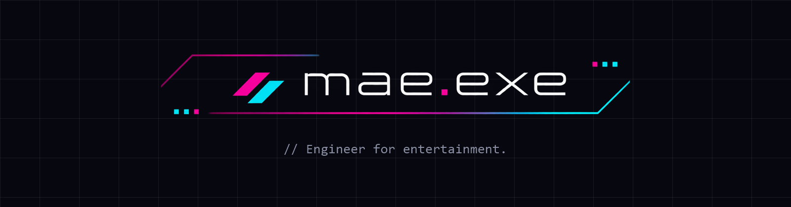

<div align="center">



<br>

**設計から、遊べるところまで。**<br>
エンジニアの手でつくる、Web・ゲーム・3DCG・ツールの作品集

<br>

[](https://mae-mei-2121.github.io/mae-profile/)
[](https://mae-mei-2121.github.io/mae-profile/)


</div>

---

## Works

作品の詳しい紹介は、[サイト](https://mae-mei-2121.github.io/mae-profile/)で見られます。

| No. | Title | 概要 | Status |
|:---:|:---|:---|:---:|
| **WEB 01** | [**既読文庫**](https://mae-mei-2121.github.io/mae-profile/web/01/index.html) | トーク画面のように読める、架空の小説投稿サイト |  |
| WEB 02–06 | — | Webサイト・ランディングページ |  |
| GAME 01–03 | — | ブラウザゲーム |  |
| 3DCG 01–03 | — | 3Dモデル（Three.js） |  |
| TOOL 01–03 | — | ツール |  |

---

## Tech

- **1作品 = 1ファイル**：CSS・JavaScript・本文データまで、HTML 1枚に収めています
- **ビルド不要・フレームワークなし**：素の HTML / CSS / JavaScript だけで動きます
- **画像は差し替え式**：決まった場所に画像を置くと、仮の枠から自動で切り替わります
- **スマホ対応**：幅 375px でも崩れないレイアウト

---

## Structure

```
mae-profile/
├── index.html            # トップ（Works 一覧）
├── assets/               # ロゴ・READMEのバナー
├── thumbs/               # 作品のサムネイル（16:9）
└── web/
    └── 01/               # 既読文庫
        ├── index.html
        └── img/          # ロゴ・表紙・挿絵
```

---

## Run Locally

ビルドは不要です。リポジトリを取得して、`index.html` をブラウザで開くだけで動きます。

```bash
git clone https://github.com/mae-mei-2121/mae-profile.git
```

---

<div align="center">

**メイ（Mae）** · Engineer / Creator<br>
[](https://github.com/mae-mei-2121)

<sub>© 2026 mae.exe All rights reserved.<br>
掲載している文章・画像・プログラムの無断転載・複製を禁止します。作品に登場する人物・団体・サービスはすべて架空です。</sub>

</div>
